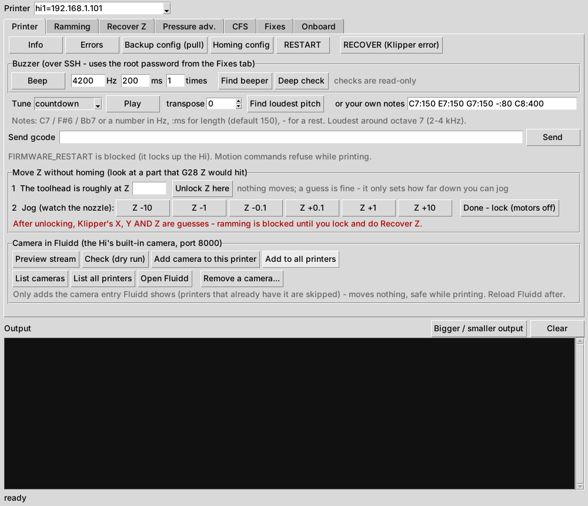
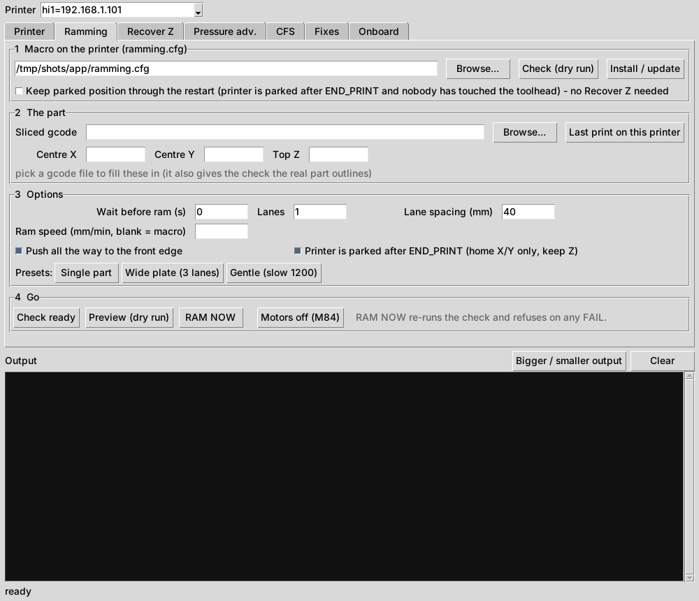
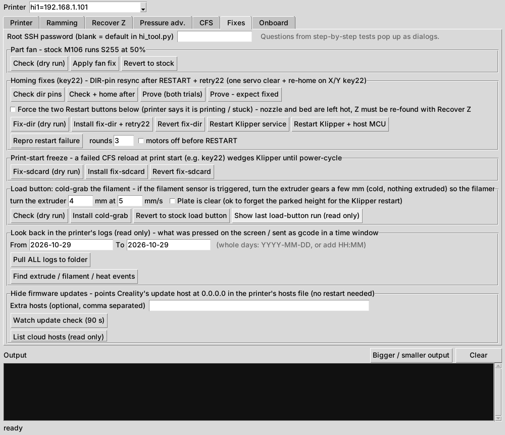
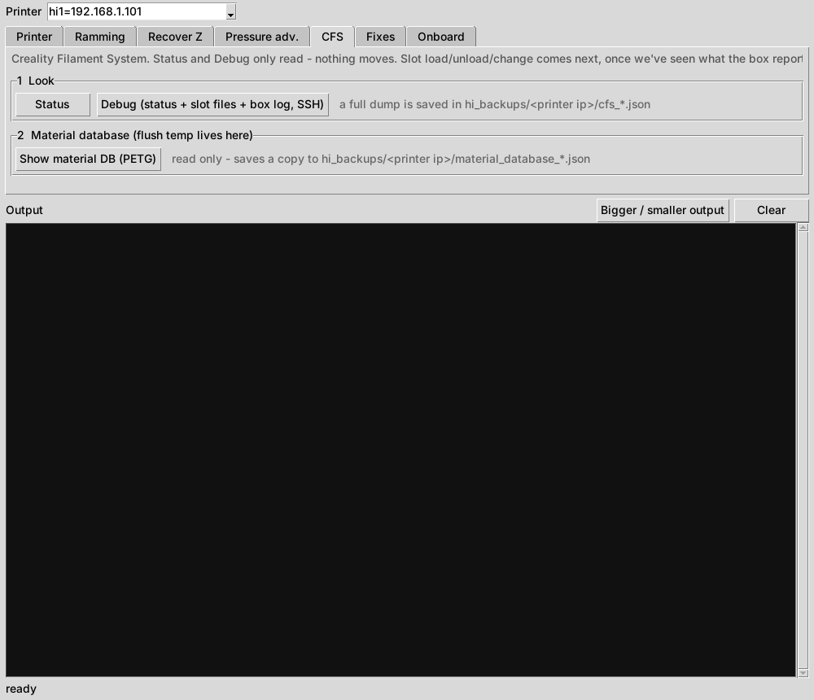
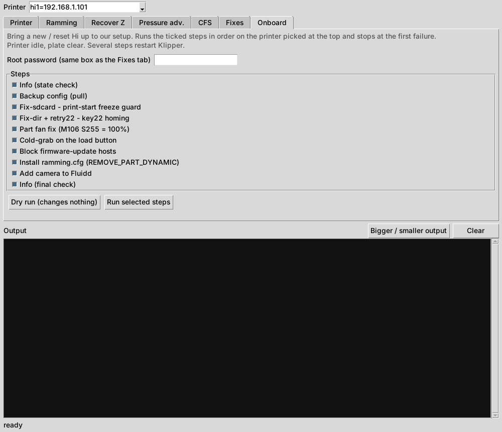

# Creality Hi Tool

A desktop toolkit for the **Creality Hi** (Klipper + Moonraker) printers. It handles diagnostics, backups, homing fixes, pressure advance calibration and automatic part removal, all over your LAN.

It started as a fix for the Hi's **key22 "No trigger on y after full movement"** homing crash and grew into a full maintenance tool for a small fleet of Hi printers.

- Pure standard-library Python 3.8+ (Windows, macOS, Linux). `paramiko` is installed automatically the first time you use an SSH feature.
- A Tkinter GUI (`hi_gui.py`) and the same features on the command line (`hi_tool.py`).
- Works on one printer or many at once. If one printer fails, the others still run, and you get a summary at the end.

> **Use at your own risk.** Some features patch Creality's Klipper Python files or `/etc/hosts` over SSH. Every change is backed up first and can be reverted, but you are modifying printer firmware files. Not affiliated with Creality.

## Safety rules built in

- **Never sends `FIRMWARE_RESTART`.** On the Hi it locks the printer until you power-cycle it. Only the host `RESTART` is used, and the console blocks `FIRMWARE_RESTART` too.
- Refuses to write, restart or move while a printer is printing or paused (unless you force it).
- Takes a full backup before changing a file, verifies each upload by checksum, and rolls back automatically if Klipper doesn't come back `ready`.
- Never retries motion gcode automatically, because a timeout doesn't mean the move didn't run.
- Every patch is a **dry run by default** and shows you the diff first.

## Screenshots

The GUI has one tab per job. A few of them:

| Printer: info, backups, errors, G-code console, camera | Ramming: automatic part removal |
|---|---|
|  |  |

| Fixes: key22 homing, part fan, update block and more | CFS: status and material database |
|---|---|
|  |  |

| Onboard: run the usual fixes on a new printer in one go |
|---|
|  |

## Getting started

**Windows**

1. Download the repo (green **Code** button, then **Download ZIP**) and unzip it anywhere.
2. Double-click **`hi_gui.bat`**. If Python isn't installed it offers to install Python 3.12 for you (no admin rights needed), then opens the tool.
3. First run: the **Add printers** window opens and scans your network. New printers are pre-selected, so click **Add selected**. You can also type an address, or just the last number (`114`), and press **Add**. Printers are saved to `printers.txt`, and you can reopen the window any time with the **Add printers...** button.
4. For anything over SSH, enable root on the printer's screen and enter the root password in the GUI's **Fixes** tab.

**macOS / Linux:** install Python 3.8+ with Tk, then run `python3 hi_gui.py`.

Ports tried, in order: 4408 (Creality web UI proxy), 7125 (Moonraker), 80.

## What's in the GUI

| Tab | What it does |
|---|---|
| **Printer** | Info (Klipper state, versions, homed axes), backup of all config + logs, recent errors grouped by Creality key code, a gcode console, host RESTART, recovery when Klipper is in error, and Klipper `M300`/`BEEP` on the Hi's built-in buzzer |
| **Ramming** | Automatic part removal with the stock toolhead casing (`REMOVE_PART_DYNAMIC`, see [RAMMING.md](RAMMING.md)): install/update the macro (optionally keeping a parked toolhead position across the Klipper restart), a readiness check that moves nothing, running it from a sliced file, and a **Last print on this printer** button that downloads the printer's last gcode so you don't have to find it |
| **Recover Z** | After a restart with parts still on the plate: home X/Y, move to a clear spot and set Z without `G28 Z` (paper test, or a measured gap from a ruler); jog Z without homing |
| **CFS** | Read-only status and debug info for the CFS box, and a viewer for the box's material database (`cfs-material`) |
| **Onboard** | One-click bring-up for a new printer: state check, config backup, then the fixes below in order (print-start guard, key22 fix, part fan, cold-grab, update block, ramming macro, camera) with a final check. Runs as a dry run first and stops at the first problem |
| **Pressure adv.** | Live/saved K, the Creality PA lock and silent mode, line tests, mapping a sliced Orca PA tower to K, logging K changes live during a print, a results notebook, and a guide |
| **Fixes** | Homing fixes for key22 (see below), the CFS print-start hang fix, a true-100% part fan, blocking firmware update checks, the Fluidd webcam, and pulling all logs |

## The fixes

| Fix | Problem | What it changes |
|---|---|---|
| `fix-homing` | A latched X/Y servo fault (key789) after a crash blocks homing | Adds a servo fault clear to the start of `[homing_override]` |
| `fix-dir` | After a host `RESTART`, Creality's servo setup can leave the Y DIR pin flipped, so the next homing move goes the wrong way into the end (key22) | Patches `homing.py`: DIR-pin resync after restart, plus one servo-clear and retry when an X/Y homing move ends in key22 |
| `fix-sdcard` | A failing CFS reload at print start wedges Klipper (cancel/RESTART hang until power-cycle) | Patches `virtual_sdcard.py` so the print ends with an error instead |
| `fix-fan` | Stock `M106` runs S255 at only 50% outside sport mode | `S255` = true 100% |
| `fix-grab` | The load button heats with the filament loose, so it can slip out | If the filament sensor is triggered, turns the extruder a few mm cold so it grips while heating |
| `block-ota` | You want to stay on your current firmware | Points Creality's update hosts at 0.0.0.0 in `/etc/hosts` (backup kept, `--revert` removes it) |

Patched files are marked `# HI-FIX ...`, and the original is kept on the printer as `<file>.hi-orig` and in your local `hi_backups/` folder.

Diagnostic commands are included to prove each bug before you fix it: `check-dir`, `prove-dir`, `test-home`, `repro-restart`, `repro-fault` and `diagnose-home`.

## Command line

Every GUI button runs a `hi_tool.py` command. Run `python hi_tool.py -h` for the full list. Examples:

```
python hi_tool.py info hi1=192.168.1.101
python hi_tool.py errors -f printers.txt
python hi_tool.py fix-dir 192.168.1.101            # dry run, shows the diff
python hi_tool.py fix-dir 192.168.1.101 --apply
python hi_tool.py pa status 192.168.1.101
```

If all your printers share a subnet, set `SUBNET` near the top of `hi_tool.py`. You can then use just the last number (`101`).

## Extra files

- `ramming.cfg`: the `REMOVE_PART_DYNAMIC` macro (installed by the Ramming tab).
- `macros/hi_filament.cfg`: `HI_LOAD` / `HI_UNLOAD` for single-colour use **without** a CFS (the stock load/unload macros fail with no box).
- `macros/hi_swap.cfg`: `HI_SWAP`, a manual mid-print colour change driven by the Resume button (no CFS needed).
- `fan_check.py`: checks the fans (none of the Hi's fans have a tachometer), with an optional noise test.
- `extras/orca_bottom_fan.py`: an OrcaSlicer post-processing script that forces full part-fan on the bottom layers to stop the bottom edge curling on PETG.

## License

MIT
